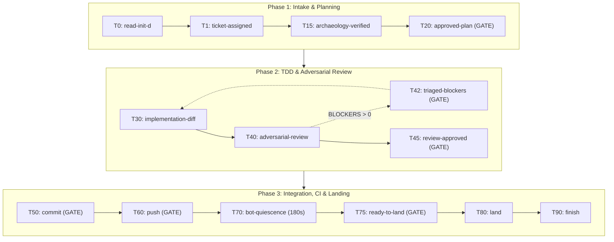

<p align="center">
  
</p>

<h1 align="center">Makefile Workflow Skill for AI Coding Agents</h1>

<p align="center">
  <a href="LICENSE"></a>
  <a href="https://github.com/hedges333/makefile-workflow-skill"></a>
  <a href="https://github.com/hedges333/makefile-workflow-skill"></a>
  <a href="https://github.com/hedges333/makefile-workflow-skill"></a>
</p>

<p align="center">
  Compaction-immune, DAG-based software engineering for Google Antigravity, Claude Code, Cursor, GitHub Copilot, and ChatGPT.
</p>

---

## Table of Contents

- [About](#about)
- [Installation](#installation)
- [Quickstart](#quickstart)
- [Usage Guide](#usage-guide)
  - [How to Start a Ticket](#how-to-start-a-ticket)
  - [The 9-Target Makefile DAG](#the-9-target-makefile-dag)
  - [Human Pause Gates](#human-pause-gates)
- [Configuration & Custom Models](#configuration--custom-models)
- [Multi-Agent Setup & Enforcement](#multi-agent-setup--enforcement)
- [Polyglot Support: 22 Languages](#polyglot-support-22-languages)
- [Architecture & Foundations](#architecture--foundations)
- [Test Safety & Data Isolation](#test-safety--data-isolation)
- [Request History Ledger](#request-history-ledger)
- [License & Acknowledgments](#license--acknowledgments)

---

## About

The **Makefile Workflow** is a disciplined orchestration engine for AI coding assistants. Standard AI coding agents often fail on long tasks:
1. They run out of context and forget earlier instructions (the 200k-token compaction problem).
2. They commit or push unreviewed code without permission.
3. They write tests after the code, which pass only by accident.
4. They refactor unrelated files and introduce regressions.

This workflow solves these problems with four simple techniques:

- **The Recipe Board (Makefile DAG)**: The agent follows a Directed Acyclic Graph. It cannot write code before planning, and cannot commit before testing.
- **The Memory Tattoo (Memento Pattern)**: The agent saves progress to disk under `.workflow/state/` (`00_governance.md`, `10_ticket.md`, `20_plan_approved.md`, etc.). Because each project repository has its own isolated `.workflow/state/` folder, tasks in different projects or terminal windows never interfere with each other. If the agent loses context or restarts, it resumes in seconds from disk.
- **Human Pause Gates**: The agent halts at key checkpoints (Plan, Review, Commit, Push, and Land) and waits for your explicit approval in chat.
- **Ephemeral Subagents (Worker Bees)**: Heavy tasks (file searches, test runs) run in isolated child agents. The main supervisor agent stays small and never runs out of memory.

Based on Randal L. Schwartz's [*Synthetic Scars* series on DEV.to](https://dev.to/randalschwartz/series/44156) and public Gist `598a1f2b5760a23c1d70b57e9e85393f`.

---

## Installation

### Option 1: Google Antigravity CLI (`agy`)
Run this command in your terminal:
```bash
agy plugin install https://github.com/hedges333/makefile-workflow-skill
```
Or install from a local clone:
```bash
agy plugin install .
```

### Option 2: Automated Bash Installer
```bash
curl -fsSL https://raw.githubusercontent.com/hedges333/makefile-workflow-skill/main/install.sh | bash
```

### Option 3: Using Make
```bash
make install
```

---

## Quickstart

Get started with your first task in 60 seconds:

1. **Open your project** in your terminal or IDE with your AI assistant active.
2. **Describe your task in chat**:
   > *"Add a health check endpoint at `/api/health` that returns uptime in seconds."*
3. **Watch the agent set up the ticket**:
   - The agent creates a dedicated branch (`ticket/feat-health-endpoint`).
   - The agent inspects your repository and writes a plan.
4. **Approve the plan at Target 20**:
   - The agent prints the plan in chat and pauses.
   - Reply: `"Plan approved. Proceed."`
5. **Review and approve**:
   - The agent writes failing tests first (Red), implements the endpoint (Green), and conducts a Six-Pillar review.
   - Once the review passes, reply `"Approved. Commit and push."` at the pause gates.

---

## Usage Guide

### How to Start a Ticket

You do not need an external issue tracker to use this workflow. You can start a ticket in three convenient ways:

#### Way 1: Direct Prompt Requirements (Most Common)
You describe your feature, bug fix, or refactor directly in chat:
- Example: `"Add an endpoint /api/v1/export that returns user reports in CSV format."`
- Example: `"Fix the bug where the date picker resets on February 29th."`

**What happens:**
1. The agent synthesizes a ticket slug (such as `feat-export-csv` or `fix-leap-year-picker`).
2. The agent checks that `git status` is clean on `main`.
3. The agent creates and checks out a feature branch: `git checkout -b ticket/<slug>`.
4. The agent writes your requirements to `.workflow/state/10_ticket.md` and displays the live readerboard.

#### Way 2: From an Existing GitHub Issue
If your project tracks issues on GitHub:
- Example: `"Work on issue #42"` or `"Resolve bug https://github.com/org/repo/issues/42"`.

**What happens:**
1. The agent runs `gh issue view 42` to read the issue title, description, and comments.
2. The agent creates the branch: `git checkout -b ticket/42-fix-auth-timeout`.
3. The agent records the issue details in `state/10_ticket.md`.

#### Way 3: Exploring the Backlog
If you want the agent to suggest what to work on next:
- Example: `"What is next on the backlog?"` or `"Check open issues on GitHub."`

**What happens:**
1. The agent queries open issues (`gh issue list`).
2. The agent presents candidates sorted by priority.
3. You choose one, and the agent begins Target 10.

---

### The 9-Target Makefile DAG

The workflow progresses through nine milestone targets:



- **Target 00 (`read-init-d`)**: Restores state cards from `.workflow/state/*.md`.
- **Target 10 (`ticket-assigned`)**: Captures ticket scope and branches `ticket/<id>-<slug>`.
- **Target 15 (`archaeology-verified`)**: Scans languages, subprojects, and test suites.
- **Target 20 (`approved-plan`)**: **Human Pause Gate**. Presents plan and notes any test changes.
- **Target 30 (`implementation-diff`)**: Red-Green-Refactor TDD. Targeted subproject test loops.
- **Target 40 (`adversarial-review`)**: Runs Six-Pillar code audit (Intent, Verification, Architecture, Blast Radius, Reviewer Defense, Immune Defenses).
- **Target 42 (`triaged-blockers`)**: **Human Pause Gate** (if review finds blockers).
- **Target 45 (`approved-review`)**: Review sign-off when 0 blockers remain.
- **Target 50 (`commit`)**: **Human Pause Gate**. Runs full monorepo tests, formats code, and requests commit approval.
- **Target 60 (`push`)**: **Human Pause Gate**. Verifies mergeability, pushes branch, opens pull request.
- **Target 70 (`bot-quiescence`)**: Ephemeral triager polls CI and bots until 180 seconds of silence.
- **Target 75 (`ready-to-land`)**: **Human Pause Gate**. Evaluates merge policy and asks for landing approval.
- **Target 80 (`land`)**: Squash-merges PR, deletes remote branch, switches to default branch.
- **Target 90 (`finish`)**: Writes permanent record to `.workflow/history.json` and `.workflow/history.md`.

---

### Human Pause Gates

The agent pauses at five standard approval checkpoints. Reply in chat to proceed:

| Gate | Target | When It Triggers | How to Reply |
| :--- | :--- | :--- | :--- |
| **Plan Gate** | `T20` | After archaeology and planning | `"Plan approved. Proceed."` (or request changes) |
| **Blocker Gate** | `T42` | If code review catches blockers | `"Approved. Fix blockers 1 and 2."` |
| **Commit Gate** | `T50` | After full tests and formatting | `"Commit message approved. Commit code."` |
| **Push Gate** | `T60` | After clean tree verification | `"Approved. Push branch and open PR."` |
| **Landing Gate** | `T75` | After CI passes and bots quiesce | `"All checks green. Squash and merge."` |

---

## Configuration & Custom Models

You can customize which AI models handle specific roles without editing plugin files.

### 1. Workspace or Global Configuration File
Copy [`.workflow/config.json.example`](./.workflow/config.json.example) to `.workflow/config.json` (workspace) or `~/.gemini/config/makefile-workflow.json` (global):

```json
{
  "models": {
    "adversarial-critic": "gemini-4-argon-high",
    "archaeology-worker": "gemini-3.8-flash-low",
    "tdd-worker": "gemini-3.8-flash-medium",
    "triage-worker": "gemini-3.8-flash-low"
  },
  "review": {
    "maxReviewRounds": 3,
    "strictSixPillars": true
  }
}
```

### 2. Environment Variables
```bash
export MAKEFILE_WORKFLOW_CRITIC_MODEL="gemini-4-argon-high"
export MAKEFILE_WORKFLOW_WORKER_MODEL="gemini-3.8-flash-low"
```

### 3. Interactive IDE Model Switch Reminders
In interactive tools (Cursor, Copilot, ChatGPT), the agent cannot change models via API. At **Target 40 (Six Pillars Review)**, the agent reminds you in chat:
> *"👉 Please switch the model picker to your deep-reasoning model (such as Claude 3.5 Sonnet or o1) for the Six-Pillar review."*

Once approved at Target 45, the agent reminds you that you can switch back to your faster model.

For full configuration details, see [13. Configuration & User Preferences](./skills/makefile-workflow/references/13_configuration_and_user_preferences.md).

---

## Multi-Agent Setup & Enforcement

| Platform | Enforcement Level | Setup Method |
| :--- | :--- | :--- |
| **Google Antigravity** | **Deterministic Gate (100%)** | `agy plugin install https://github.com/hedges333/makefile-workflow-skill`. Enforced by `hooks.json` and `rules/AGENTS.md`. |
| **Claude Code** | **Tool-Mediated Gate (80–95%)** | Discovers [`CLAUDE.md`](./CLAUDE.md) automatically. Connect MCP server: `claude mcp add makefile-workflow -- python3 /path/to/mcp/server.py`. |
| **Cursor** | **Rule Advisory (50–70%)** | Automatically reads [`.cursorrules`](./.cursorrules) and [`.cursor/rules/makefile-workflow.mdc`](./.cursor/rules/makefile-workflow.mdc). Add MCP server in Cursor Settings -> Features -> MCP. |
| **GitHub Copilot** | **Prompt Advisory (30–50%)** | Automatically reads [`.github/copilot-instructions.md`](./.github/copilot-instructions.md) in VS Code or CLI. |
| **ChatGPT** | **Prompt Advisory (30–50%)** | Copy prompt from [`adapters/chatgpt/instructions.md`](./adapters/chatgpt/instructions.md) into Custom GPT or system instructions. |

---

## Polyglot Support: 22 Languages

The Archaeology Worker (Target 15) automatically detects languages and subprojects. If no test harness exists, the agent scaffolds standard tests before writing feature code:

| Language | Test Runner | Scaffolding File | Lint & Format | Guide |
| :--- | :--- | :--- | :--- | :--- |
| **Python** | `pytest` | `tests/test_smoke.py` | `ruff`, `black` | [Python Guide](./skills/makefile-workflow/references/polyglot/python.md) |
| **TypeScript / JS** | `vitest` / `node --test` | `tests/smoke.test.ts` | `eslint`, `prettier` | [TypeScript Guide](./skills/makefile-workflow/references/polyglot/typescript_javascript.md) |
| **Rust** | `cargo test` | `tests/smoke_test.rs` | `clippy`, `rustfmt` | [Rust Guide](./skills/makefile-workflow/references/polyglot/rust.md) |
| **Go** | `go test` | `smoke_test.go` | `golangci-lint`, `gofmt` | [Go Guide](./skills/makefile-workflow/references/polyglot/go.md) |
| **Dart / Flutter** | `flutter test` | `test/smoke_test.dart` | `dart analyze`, `dart format` | [Dart Guide](./skills/makefile-workflow/references/polyglot/dart_flutter.md) |
| **PHP** | `phpunit` | `tests/SmokeTest.php` | `phpstan`, `php-cs-fixer` | [PHP Guide](./skills/makefile-workflow/references/polyglot/php.md) |
| **C / C++** | `ctest` | `tests/smoke_test.c` | `clang-tidy`, `clang-format` | [C/C++ Guide](./skills/makefile-workflow/references/polyglot/c_cpp.md) |
| **Elixir** | `mix test` | `test/smoke_test.exs` | `credo`, `mix format` | [Elixir Guide](./skills/makefile-workflow/references/polyglot/elixir.md) |
| **Perl** | `prove` | `t/00-smoke.t` | `perlcritic`, `perltidy` | [Perl Guide](./skills/makefile-workflow/references/polyglot/perl.md) |
| **Java / Kotlin / Scala** | `mvn` / `gradle` / `sbt` | `SmokeTest.java` / `kt` / `scala` | Spotless, `ktlint`, `scalafmt` | [JVM Guide](./skills/makefile-workflow/references/polyglot/java_kotlin_scala.md) |
| **C# (.NET)** | `dotnet test` | `tests/SmokeTests.cs` | `dotnet format` | [C# Guide](./skills/makefile-workflow/references/polyglot/csharp_dotnet.md) |
| **PowerShell** | `Invoke-Pester` | `tests/Smoke.Tests.ps1` | `PSScriptAnalyzer` | [PowerShell Guide](./skills/makefile-workflow/references/polyglot/powershell.md) |
| **Swift** | `swift test` | `Tests/SmokeTests/SmokeTests.swift` | `swiftlint`, `swiftformat` | [Swift Guide](./skills/makefile-workflow/references/polyglot/swift.md) |
| **Ruby** | `rspec` | `spec/smoke_spec.rb` | `rubocop` | [Ruby Guide](./skills/makefile-workflow/references/polyglot/ruby.md) |
| **SQL & Migrations** | `pg_prove` / `dbt` | `tests/test_schema.sql` | `sqlfluff` | [SQL Guide](./skills/makefile-workflow/references/polyglot/sql_migrations.md) |
| **R, Julia & Lua** | `testthat`, `Pkg.test`, `busted` | `test-smoke.R`, `runtests.jl` | `lintr`, `JuliaFormatter` | [Scientific Guide](./skills/makefile-workflow/references/polyglot/scientific_r_julia_lua.md) |

---

## Architecture & Foundations

For senior engineers, the workflow grounds its operational mechanics in computer science and linguistic theory:

* **Stuart Feldman (1976)**: Declarative dependency evaluation via Directed Acyclic Graphs (DAG). Milestones are targets with prerequisites, not loose chronological conversation steps.
* **Fernando Flores (1986) & John Searle (1985)**: Committed speech acts. Conversation transitions through a formal grammar:
  `TicketSession ::= !Request Negotiation (!DeclareApprove Execution | !DeclareAbort)`
* **Nuel Belnap (1977)**: Four-valued epistemic logic. During codebase archaeology, facts are classified as `ESTABLISHED` ($T$), `CONTRADICTED` ($B$), `UNKNOWN` ($N$), or `RETRACTED` ($F$).
* **AT&T System V `init.d`**: Numbered state cards evaluated in lexical order on session startup to restore system state.

---

## Test Safety & Data Isolation

The workflow strictly isolates automated test runs from live production environments:
1. Tests must point to dedicated test databases (`*_test`), in-memory databases, or mock fixtures.
2. File operations during tests must use temporary scratch directories.
3. PreToolUse lifecycle hooks intercept commands and block production connection strings before the shell executes them.

---

## Request History Ledger

Completed tickets are recorded in `.workflow/history.json` and `.workflow/history.md`. This gives your team a permanent, version-controlled audit trail of all tickets, branches, PRs, and failure vaccines earned by AI agents over time.

---

## License & Acknowledgments

### License
This project is licensed under the **MIT License** — see the [`LICENSE`](./LICENSE) file for details.

### Acknowledgments
- **Methodology & Architecture**: Designed by [**Randal L. Schwartz**](https://github.com/RandalSchwartz) in the [*Synthetic Scars* series on DEV.to](https://dev.to/randalschwartz/series/44156) and GitHub Gist `598a1f2b5760a23c1d70b57e9e85393f`.
- **Packaging & Polyglot Implementation**: Packaged and maintained by [**Mark Hedges**](https://github.com/hedges333).
- **Documentation Standards**: Compliant with **ASD-STE100 Simplified Technical English** via the [SimpleEnglish plugin](https://github.com/AminBlg/SimpleEnglish).
