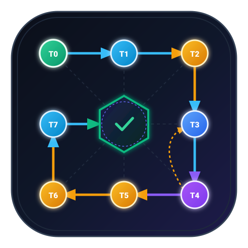
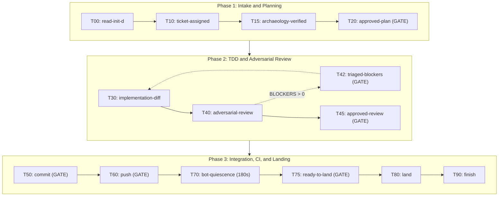

<p align="center">
  
</p>

<h1 align="center">Makefile Workflow Skill for AI Coding Agents</h1>

<p align="center">
  <a href="LICENSE"></a>
  <a href="https://github.com/hedges333/makefile-workflow-skill"></a>
  <a href="https://github.com/hedges333/makefile-workflow-skill"></a>
  <a href="https://github.com/hedges333/makefile-workflow-skill"></a>
</p>

<p align="center">
  Compaction-immune, DAG-based software engineering for Google Antigravity, Claude Code, Cursor, GitHub Copilot, and ChatGPT.
</p>

---

## Table of Contents

- [About](#about)
- [Installation](#installation)
- [Quickstart](#quickstart)
- [Usage Guide](#usage-guide)
  - [How to Start a Ticket](#how-to-start-a-ticket)
  - [The 14-Target Makefile DAG](#the-14-target-makefile-dag)
  - [Human Pause Gates](#human-pause-gates)
- [Configuration and Custom Models](#configuration-and-custom-models)
- [Multi-Agent Setup and Enforcement](#multi-agent-setup-and-enforcement)
- [Polyglot Support: 27 Languages](#polyglot-support-27-languages)
- [Architecture and Foundations](#architecture-and-foundations)
- [Test Safety and Data Isolation](#test-safety-and-data-isolation)
- [Request History Ledger](#request-history-ledger)
- [License and Acknowledgments](#license-and-acknowledgments)

---

## About

The Makefile Workflow is a task orchestration plugin for AI coding assistants. Unstructured AI coding sessions often fail on long tasks for four reasons:

1. Context loss: When a session reaches token limits, chat compression drops earlier safety rules.
2. Unapproved commits: The agent commits or pushes unreviewed code without human permission.
3. Weak tests: The agent writes tests after writing buggy code, so the tests pass by mistake.
4. Scope creep: The agent edits unrelated files and introduces regressions.

This plugin prevents those failures with four mechanisms:

1. Makefile DAG: The agent follows a DAG (a dependency graph without loops). It cannot write code before planning, and it cannot commit before testing.
2. Memento state files: The agent writes numbered progress cards inside `<workspace>/.workflow/state/`. Each repository keeps its own state directory, so parallel sessions in different projects never collide.
3. Human pause gates: The agent stops at six checkpoints (Plan, Blocker Triage, Review, Commit, Push, and Landing) and waits for your approval in chat.
4. Ephemeral subagents: Heavy file scans, test runs, and CI checks run in child workers. The main agent context stays small and avoids chat compression.

This project builds on Randal L. Schwartz's [*Synthetic Scars* series on DEV.to](https://dev.to/randalschwartz/series/44156) and public Gist `598a1f2b5760a23c1d70b57e9e85393f`.

---

## Installation

### Method 1: Google Antigravity CLI (`agy`)

Install directly from GitHub in your terminal:

```bash
agy plugin install https://github.com/hedges333/makefile-workflow-skill
```

If you cloned this repository locally, run this command inside the repository directory:

```bash
agy plugin install .
```

### Method 2: Bash Installer Script

Run the installer script with `curl` and `bash`:

```bash
curl -fsSL https://raw.githubusercontent.com/hedges333/makefile-workflow-skill/main/install.sh | bash
```

### Method 3: GNU Make

Run `make install` from a local clone to validate, test, and install the plugin:

```bash
make install
```

---

## Quickstart

Run your first workflow task in five steps:

1. Open your project repository in your terminal or IDE with your AI coding agent active.
2. Describe your task in chat, for example: `"Add a health endpoint at /api/health that returns uptime in seconds."`
3. Wait while the agent creates branch `feat/1-health-endpoint`, scans your codebase, and writes `.workflow/state/20_plan.md`.
4. Read the plan in chat at Target 20 and reply: `"Plan approved. Proceed."`
5. Review the test results and Six-Pillar code audit, then reply `"Approved"` at each pause gate to commit, push, and merge.

---

## Usage Guide

### How to Start a Ticket

You do not need an external issue tracker to use this plugin. You can start work in three ways.

#### Way 1: Describe Requirements in Chat

State your feature, bug fix, or refactor directly in chat, for example `"Add CSV export to /api/v1/reports"` or `"Fix leap-year reset in the date picker."`

1. The agent reads `.workflow/history.json` to assign the next local task number.
2. The agent makes sure that `git status --short` is clean on `main`.
3. The agent excludes `.workflow/state/` in `.git/info/exclude` so state cards never pollute commits.
4. The agent creates branch `feat/<N+1>-<slug>` or `fix/<N+1>-<slug>` and writes `.workflow/state/10_ticket.md`.

#### Way 2: Reference a GitHub, Jira, or Linear Issue

Give an issue number or URL in chat, for example `"Resolve issue #42"` or `"Fix AUTH-102."`

1. The agent runs `gh issue view 42` to read the title, body, and comments as untrusted data.
2. The agent creates branch `fix/42-auth-timeout` or `feat/AUTH-102-jwt-refresh`.
3. The agent writes the ticket scope to `.workflow/state/10_ticket.md` and advances to Target 15.

#### Way 3: Query the Open Backlog

Ask the agent what to work on next, for example `"Show open issues on GitHub."`

1. The agent queries open issues with `gh issue list` and sorts them by priority (`P0` through `P3`).
2. The agent lists the candidates in chat so that you can pick one.
3. After you choose an issue, the agent starts Target 10.

---

### The 14-Target Makefile DAG

Every ticket moves through 14 dependency targets grouped into three phases:



- Target 00 (`read-init-d`): Reads Memento state cards from `.workflow/state/*.md`.
- Target 10 (`ticket-assigned`): Records ticket scope and creates branch `feat/<id>-<slug>`, `fix/<id>-<slug>`, or `ticket/<id>-<slug>`.
- Target 15 (`archaeology-verified`): Scans subprojects, detects languages, and checks existing test suites.
- Target 20 (`approved-plan`): Human Pause Gate. Writes `.workflow/state/20_plan.md` and discloses any test changes.
- Target 30 (`implementation-diff`): Runs Red-Green-Refactor test-driven development (TDD, writing failing tests before feature code).
- Target 40 (`adversarial-review`): Locks the Git Merkle tree hash (a cryptographic snapshot of staged files) and runs the Six-Pillar audit.
- Target 42 (`triaged-blockers`): Human Pause Gate when the code audit reports one or more blockers.
- Target 45 (`approved-review`): Human Pause Gate for review sign-off when zero blockers remain.
- Target 50 (`commit`): Human Pause Gate. Formats code, runs all repository tests, and asks to commit.
- Target 60 (`push`): Human Pause Gate. Tests mergeability with `git merge-tree`, pushes the branch, and opens a pull request.
- Target 70 (`bot-quiescence`): Polls CI checks and waits 180 seconds for review bots to finish commenting.
- Target 75 (`ready-to-land`): Human Pause Gate. Presents CI status and the 7-criteria merge policy table.
- Target 80 (`land`): Squash-merges the pull request, deletes the ticket branch, and updates `main`.
- Target 90 (`finish`): Records process lessons and appends the task to `.workflow/history.json` and `.workflow/history.md`.

---

### Human Pause Gates

The workflow stops at six human approval checkpoints. Reply in chat to continue:

| Gate | Target | Trigger Condition | Example Reply |
| :--- | :--- | :--- | :--- |
| Plan Gate | `T20` | Archaeology and plan file complete | `"Plan approved. Proceed."` |
| Blocker Gate | `T42` | Six-Pillar review reports blockers | `"Approved. Fix blockers 1 and 2."` |
| Review Gate | `T45` | Six-Pillar review reports zero blockers | `"Review approved. Proceed to commit."` |
| Commit Gate | `T50` | Full test suite and linters pass | `"Commit message approved. Commit."` |
| Push Gate | `T60` | Branch merges cleanly with `main` | `"Approved. Push branch and open PR."` |
| Landing Gate | `T75` | Remote CI passes and review bots finish | `"All checks green. Squash and merge."` |

---

## Configuration and Custom Models

You can assign specific AI models to each worker role without editing plugin files. The plugin leaves `./agents/*.md` free of hardcoded model names so that every user controls their own cost and reasoning tiers.

### 1. Workspace or Global Configuration File

Copy [`.workflow/config.json.example`](./.workflow/config.json.example) to `<workspace>/.workflow/config.json` (per project) or `~/.gemini/config/makefile-workflow.json` (global):

```json
{
  "models": {
    "adversarial-critic": "pro",
    "archaeology-worker": "flash",
    "tdd-worker": "inherit",
    "triage-worker": "flash"
  },
  "review": {
    "maxReviewRounds": 3,
    "strictSixPillars": true
  },
  "ci": {
    "pollIntervalSeconds": 30,
    "quiescenceSeconds": 180
  },
  "database": {
    "prodDatabases": [],
    "testDatabases": [],
    "prodHosts": []
  }
}
```

If you write concrete model names such as `gemini-4-argon-high`, `workflow_get_config` maps them to Antigravity tiers under `agyModelTiers`. Valid Antigravity subagent tiers are `pro`, `flash`, `flash_lite`, and `inherit`. You can also list custom live and test database names under `database` so hardware hooks block live databases and allow declared test databases.

### 2. Environment Variables

Set environment variables in your shell profile to override model roles and database guards across projects:

```bash
export MAKEFILE_WORKFLOW_CRITIC_MODEL="gemini-4-argon-high"
export MAKEFILE_WORKFLOW_WORKER_MODEL="gemini-3.8-flash-low"
export MAKEFILE_WORKFLOW_TDD_MODEL="inherit"
export MAKEFILE_WORKFLOW_TRIAGE_MODEL="gemini-3.8-flash-low"
export MAKEFILE_WORKFLOW_PROD_DBS="billing_live,core_main"
export MAKEFILE_WORKFLOW_TEST_DBS="billing_sandbox,myapp_test"
export MAKEFILE_WORKFLOW_PROD_HOSTS="db.company.internal"
```

### 3. Interactive IDE Model Switch Reminders

Interactive IDE tools (Cursor, GitHub Copilot, ChatGPT) cannot switch models automatically through subagent calls. At Target 40, the agent prompts you to select your deep-reasoning model in the UI picker. At Target 45, the agent tells you that you can switch back. Read [13. Configuration and User Preferences](./skills/makefile-workflow/references/13_configuration_and_user_preferences.md) for full details.

---

## Multi-Agent Setup and Enforcement

Each AI platform enforces the workflow with its native extension hooks and rule files:

| Platform | Enforcement Mechanism | Setup Instructions |
| :--- | :--- | :--- |
| Google Antigravity | Lifecycle hooks (`hooks.json`), MCP server, and `rules/AGENTS.md` | Run `agy plugin install https://github.com/hedges333/makefile-workflow-skill`. |
| Claude Code | Root [`CLAUDE.md`](./CLAUDE.md) instructions and MCP server | Register MCP with `claude mcp add makefile-workflow -- python3 /path/to/mcp/server.py`. |
| Cursor | [`.cursorrules`](./.cursorrules), [`.cursor/rules/makefile-workflow.mdc`](./.cursor/rules/makefile-workflow.mdc), and MCP | Enable the MCP server in Cursor Settings under Features and MCP. |
| GitHub Copilot | [`.github/copilot-instructions.md`](./.github/copilot-instructions.md) | Automatic in VS Code and GitHub Copilot Chat when present in the repository. |
| ChatGPT | [`adapters/chatgpt/instructions.md`](./adapters/chatgpt/instructions.md) | Paste the prompt into Custom GPT instructions or project instructions. |

---

## Polyglot Support: 27 Languages

At Target 15, `archaeology-worker` detects every language and subproject in the repository. If a subproject has no test suite, the agent creates a smoke test before writing feature code:

| Language | Test Runner | Smoke Test File | Lint and Format | Guide |
| :--- | :--- | :--- | :--- | :--- |
| Python | `pytest` | `tests/test_smoke.py` | `ruff`, `black` | [Python Guide](./skills/makefile-workflow/references/polyglot/python.md) |
| TypeScript and JS | `vitest` / `node --test` | `tests/smoke.test.ts` | `eslint`, `prettier` | [TypeScript Guide](./skills/makefile-workflow/references/polyglot/typescript_javascript.md) |
| Rust | `cargo test` | `tests/smoke_test.rs` | `clippy`, `rustfmt` | [Rust Guide](./skills/makefile-workflow/references/polyglot/rust.md) |
| Go | `go test` | `smoke_test.go` | `golangci-lint`, `gofmt` | [Go Guide](./skills/makefile-workflow/references/polyglot/go.md) |
| Dart and Flutter | `flutter test` | `test/smoke_test.dart` | `dart analyze`, `dart format` | [Dart Guide](./skills/makefile-workflow/references/polyglot/dart_flutter.md) |
| PHP | `phpunit` | `tests/SmokeTest.php` | `phpstan`, `php-cs-fixer` | [PHP Guide](./skills/makefile-workflow/references/polyglot/php.md) |
| C and C++ | `ctest` | `tests/smoke_test.c` | `clang-tidy`, `clang-format` | [C/C++ Guide](./skills/makefile-workflow/references/polyglot/c_cpp.md) |
| Elixir | `mix test` | `test/smoke_test.exs` | `credo`, `mix format` | [Elixir Guide](./skills/makefile-workflow/references/polyglot/elixir.md) |
| Perl | `prove` | `t/00-smoke.t` | `perlcritic`, `perltidy` | [Perl Guide](./skills/makefile-workflow/references/polyglot/perl.md) |
| Java, Kotlin, Scala | `mvn` / `gradle` / `sbt` | `SmokeTest.java` / `kt` / `scala` | Spotless, `ktlint`, `scalafmt` | [JVM Guide](./skills/makefile-workflow/references/polyglot/java_kotlin_scala.md) |
| C# (.NET) | `dotnet test` | `tests/SmokeTests.cs` | `dotnet format` | [C# Guide](./skills/makefile-workflow/references/polyglot/csharp_dotnet.md) |
| PowerShell | `Invoke-Pester` | `tests/Smoke.Tests.ps1` | `PSScriptAnalyzer` | [PowerShell Guide](./skills/makefile-workflow/references/polyglot/powershell.md) |
| Swift | `swift test` | `Tests/SmokeTests/SmokeTests.swift` | `swiftlint`, `swiftformat` | [Swift Guide](./skills/makefile-workflow/references/polyglot/swift.md) |
| Ruby | `rspec` | `spec/smoke_spec.rb` | `rubocop` | [Ruby Guide](./skills/makefile-workflow/references/polyglot/ruby.md) |
| SQL and Migrations | `pg_prove` / `dbt` | `tests/test_schema.sql` | `sqlfluff` | [SQL Guide](./skills/makefile-workflow/references/polyglot/sql_migrations.md) |
| R, Julia, and Lua | `testthat`, `Pkg.test`, `busted` | `test-smoke.R`, `runtests.jl` | `lintr`, `JuliaFormatter` | [Scientific Guide](./skills/makefile-workflow/references/polyglot/scientific_r_julia_lua.md) |
| GDScript (Godot) | `godot --headless` (GUT / GdUnit4) | `test/unit/test_smoke.gd` | `gdlint`, `gdformat` | [GDScript Guide](./skills/makefile-workflow/references/polyglot/gdscript_godot.md) |
| Nim | `nimble test` / `testament` | `tests/t_smoke.nim` | `nim check`, `nph` / `nimpretty` | [Nim Guide](./skills/makefile-workflow/references/polyglot/nim.md) |
| Haxe | `haxe` (`utest`) | `test/SmokeTest.hx` | `checkstyle`, `formatter` | [Haxe Guide](./skills/makefile-workflow/references/polyglot/haxe.md) |
| Odin | `odin test` | `tests/smoke_test.odin` | `odin check -vet`, `odinfmt` | [Odin Guide](./skills/makefile-workflow/references/polyglot/odin.md) |
| D | `dub test` / `dmd -unittest` | `source/smoke_test.d` | `dscanner`, `dfmt` | [D Guide](./skills/makefile-workflow/references/polyglot/dlang.md) |

---

## Architecture and Foundations

Five computer science and software design models shape this workflow:

1. Stuart Feldman (1976): `make` evaluates build targets as a DAG so that prerequisites finish before downstream targets run.
2. Fernando Flores (1986) and John Searle (1985): Committed speech acts model tasks as explicit requests, promises, assertions, and human declarations.
3. Nuel Belnap (1977): Four-valued logic classifies repository facts during archaeology as `ESTABLISHED`, `CONTRADICTED`, `UNKNOWN`, or `RETRACTED`.
4. AT&T System V `init.d`: Lexically numbered files (`00_..` through `99_..`) restore execution state cleanly on startup.
5. Gang of Four (1994) and Robert Nystrom (2014): Design pattern guides ([`14_design_patterns_and_architecture.md`](./skills/makefile-workflow/references/14_design_patterns_and_architecture.md)) balance object composition, ORM encapsulation, parameterized large-dataset queries, and game frame budgets.

---

## Test Safety and Data Isolation

Automated test suites and agent commands must never touch live production systems:

1. Point all database tests to isolated `*_test` databases, local containers, in-memory databases, or mock fixtures.
2. Write temporary files during tests inside scratch directories that clean up automatically on exit.
3. In Antigravity, [`scripts/pre_tool_guard.py`](./scripts/pre_tool_guard.py) inspects shell commands before execution, blocks production database names, blocks force-pushes to `main`, and prompts for confirmation on `git commit`, `git push`, and `gh pr merge`.

---

## Request History Ledger

At Target 90, the agent appends completed task metadata to `.workflow/history.json` and `.workflow/history.md`. These files give your repository a version-controlled log of resolved issues, branches, pull requests, added tests, and codified process scars.

---

## License and Acknowledgments

### License

This repository uses the MIT License. Read [`LICENSE`](./LICENSE) for the full license text.

### Acknowledgments

- Methodology: Created by [Randal L. Schwartz](https://github.com/RandalSchwartz) in the [*Synthetic Scars* series on DEV.to](https://dev.to/randalschwartz/series/44156) and GitHub Gist `598a1f2b5760a23c1d70b57e9e85393f`.
- Plugin Packaging and Polyglot Guides: Maintained by [Mark Hedges](https://github.com/hedges333).
- Documentation Style: Written in plain English following ASD-STE100 principles from the [SimpleEnglish plugin](https://github.com/AminBlg/SimpleEnglish).
