# 00. Quickstart and Mental Model

This manual explains the core mental model of the Makefile Workflow in Simple English.

## 1. The Core Problem: Why AI Agents Fail

AI coding agents struggle with four failure modes during long coding tasks:

1. **Context Compaction Loss**: When a conversation hits token limits, runtimes compress history into a short narrative. The agent forgets negative constraints and rules.
2. **Premature Commit and Push**: The agent modifies files and immediately commits or pushes without human review.
3. **Tautological Tests**: The agent writes tests after writing code. The tests pass because they assert whatever the buggy code happens to return.
4. **Scope Creep Regressions**: The agent tries to clean up unrelated code while fixing a bug, introducing regressions.

## 2. The Four Solutions

The Makefile Workflow solves these problems with four engineering techniques:

### Solution 1: The Recipe Board (Makefile DAG)
Stuart Feldman created `make` in 1976 to manage software builds through a Directed Acyclic Graph (DAG). A DAG is a graph of steps with dependencies and no circular loops. 

Instead of a long prompt with twenty steps, the agent receives a Makefile DAG. The agent cannot bake the cake before mixing the batter. The agent cannot commit before testing, and cannot test before planning.

### Solution 2: The Memory Tattoo (Memento Pattern & State Files)
In the film *Memento*, the main character has short-term memory loss and tattoos vital facts onto his skin.

The agent writes state cards to disk under `<workspace>/.workflow/state/` (`00_governance.md`, `10_ticket.md`, `20_plan_approved.md`, `40_critic_review.md`, and `99_next_action.md`). Because each project repository has its own `.workflow/state/` directory, tasks in different terminal windows or projects never interfere with each other. If the conversation resets, compacts, or the terminal restarts, the agent reads the cards and resumes in two seconds without losing state. (In Antigravity sessions, the readerboard is also mirrored to `<brain>/readerboard.md` for UI display).

### Solution 3: The Human Safety Switches (Pause Gates)
The agent never commits, pushes, or merges code autonomously. 

At each key milestone (Plan, Review, Commit, Push, and Landing), the agent presents its findings directly in chat and pauses execution. You stay in full control.

### Solution 4: Worker Bees (Ephemeral Subagents)
Instead of running heavy test suites and file searches in the main context, the supervisor agent forks small helper subagents. The helper executes the heavy command, writes a receipt, and exits. The main agent context stays small and never runs out of memory.

## 3. The 9 Workflow Milestones

```mermaid
flowchart LR
    T0["T0: Read State"] --> T1["T1: Ticket & Branch"]
    T1 --> T15["T15: Archaeology"]
    T15 --> T20["T20: Plan Approval (Gate)"]
    T20 --> T30["T30: Red-Green TDD"]
    T30 --> T40["T40: Six Pillars Review"]
    T40 --> T45["T45: Review Approval (Gate)"]
    T45 --> T50["T50: Commit (Gate)"]
    T50 --> T60["T60: Push & PR (Gate)"]
    T60 --> T70["T70: CI & Bot Quiescence"]
    T70 --> T75["T75: Landing (Gate)"]
    T75 --> T80["T80: Merge & Mop-up"]
    T80 --> T90["T90: Finish & History"]
```

## 4. How to Talk to Your Agent

You can start the workflow with three simple prompts:

* **Start a Ticket**: `"Resolve ticket #123 using the makefile workflow."`
* **Check Status**: `"Show the current readerboard and active target."`
* **Backlog Check**: `"What is the next unassigned task on our backlog?"`

When the agent pauses at a Human Pause Gate, reply with standard guidance:
* At Plan Gate: `"Plan approved. Proceed."` (or request revisions).
* At Review Gate: `"Review approved. Proceed to commit."`
* At Commit Gate: `"Approved. Commit the changes."`
* At Landing Gate: `"CI is green. Go ahead and land."`
