# 00. Quickstart and Mental Model

This manual explains the mental model of the Makefile Workflow in plain English.

## 1. Why Unstructured AI Coding Sessions Fail

AI coding agents fail on long coding tasks in four common ways:

1. Context loss: When a session reaches token limits, chat compression removes earlier safety rules.
2. Premature commits: The agent edits files and runs `git commit` or `git push` without human review.
3. Weak tests: The agent writes tests after writing buggy code, so the tests pass by mistake.
4. Scope creep: The agent edits unrelated code during a bug fix and introduces regressions.

## 2. Four Mechanisms That Prevent Failure

### Solution 1: Makefile DAG

Stuart Feldman created `make` in 1976 to run software builds through a DAG (a dependency graph without loops). Instead of a flat prompt list, the agent evaluates 14 dependency targets. The agent cannot edit source code before planning, and it cannot commit before testing.

### Solution 2: Memento State Files

Memento state files are numbered markdown cards inside `<workspace>/.workflow/state/` (`00_governance.md` through `99_next_action.md`). Because each repository stores its own `.workflow/state/` directory, sessions in separate terminal windows or projects never overwrite one another. If chat history resets or compresses, the agent reads `.workflow/state/*.md` and resumes in seconds.

### Solution 3: Human Pause Gates

The agent never commits, pushes, or merges code on its own. At six checkpoints (Targets 20, 42, 45, 50, 60, and 75), the agent prints its findings in chat and stops tool calls until you reply.

### Solution 4: Ephemeral Subagents

Heavy directory scans, test runs, and CI checks run inside isolated child subagents. Each worker writes a short summary and exits so that the supervisor context window stays small.

## 3. The 14 Workflow Targets

```mermaid
flowchart LR
    T00["T00: Read State"] --> T10["T10: Ticket and Branch"]
    T10 --> T15["T15: Archaeology"]
    T15 --> T20["T20: Plan Gate"]
    T20 --> T30["T30: Red-Green TDD"]
    T30 --> T40["T40: Six Pillars Review"]
    T40 -. "Blockers > 0" .-> T42["T42: Blocker Gate"] -.-> T30
    T40 --> T45["T45: Review Gate"]
    T45 --> T50["T50: Commit Gate"]
    T50 --> T60["T60: Push Gate"]
    T60 --> T70["T70: CI and Bots"]
    T70 --> T75["T75: Landing Gate"]
    T75 --> T80["T80: Merge and Cleanup"]
    T80 --> T90["T90: Finish and History"]
```

## 4. How to Talk to Your Agent

Start a task or query status with direct chat prompts:

- Start from requirements: `"Add CSV export to /api/reports using the makefile workflow."`
- Start from an issue: `"Resolve GitHub issue #123."`
- View progress: `"Show the active target and readerboard."`
- View backlog: `"List the top open issues by priority."`

When the agent stops at a human pause gate, reply in chat to continue:

- Plan Gate (`T20`): `"Plan approved. Proceed."`
- Blocker Gate (`T42`): `"Approved. Fix blockers 1 and 2."`
- Review Gate (`T45`): `"Review approved. Proceed to commit."`
- Commit Gate (`T50`): `"Approved. Commit the changes."`
- Push Gate (`T60`): `"Approved. Push branch and open PR."`
- Landing Gate (`T75`): `"CI is green. Squash and merge."`
